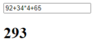

# Tool Learning Log

## Tool: **[Math.js](https://mathjs.org/)**

## Project: **Math Learning Game**


### 10/24/26:
#### Learning Log #1
* What is Math.js? Well its an open source library that supports big numbers, complex numbers, fractions, units, strings, arrays, matrices, and does symbolic compuation. While Javascripts built in math library is limited to only basic math, Math.js extends these limitation.
* To install Math.js you have to download it using `npm install mathjs`
* When installing math.js I saw many folders with files pop up in my repository. They contained `seedrandom`, `complex.js`, `decimal.js`, and more. When trying to use it on the website, and make a working calculator I had many troubles, I didnt know how to set it up. So I read the math.js docs, and after many tries I made a working prototype.
 ```html
    <input id="input" value="" oninput="out.value = eval(value)">
  
    <h1><output id="out">Welcome to my Calculator</output></h1>
```
It creates a text box where the user types their calculations, and the `oninput=""` instantly executes that and outputs it in the `<output>`. Inside the `oninput`, `value` grabs the user input, `out.value` takes the answer, and pushes it in `<output>` to display it. <br>

Calculator example:
<br>


* Websites used: [Download](https://mathjs.org/download.html), [Documentation](https://mathjs.org/docs/index.html), [Examples](https://mathjs.org/examples/index.html).

<!-- 
* Links you used today (websites, videos, etc)
* Things you tried, progress you made, etc
* Challenges, a-ha moments, etc
* Questions you still have
* What you're going to try next
-->
