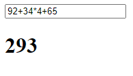
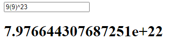
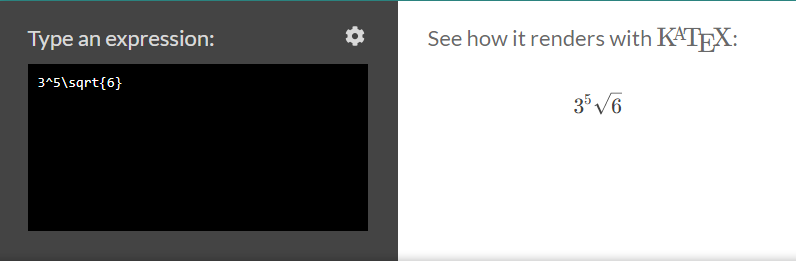
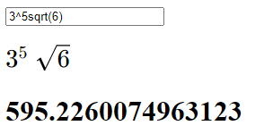

# Tool Learning Log

## Tool: **[Math.js](https://mathjs.org/)**

## Project: **Math Learning Game**

### 10/24/26:

#### Learning Log #1

- What is Math.js? Well its an open source library that supports big numbers, complex numbers, fractions, units, strings, arrays, matrices, and does symbolic compuation. While Javascripts built in math library is limited to only basic math, Math.js extends these limitation.
- To install Math.js you have to download it using `npm install mathjs`
- When installing math.js I saw many folders with files pop up in my repository. They contained `seedrandom`, `complex.js`, `decimal.js`, and more. When trying to use it on the website, and make a working calculator I had many troubles, I didnt know how to set it up. So I read the math.js docs, and after many tries I made a working prototype.

```html
<input id="input" value="" oninput="out.value = eval(value)" />

<h1><output id="out">Welcome to my Calculator</output></h1>
```

It creates a text box where the user types their calculations, and the `oninput=""` instantly executes that and outputs it in the `<output>`. Inside the `oninput`, `value` grabs the user input, `out.value` takes the answer, and pushes it in `<output>` to display it. <br>

Calculator example:
<br>



- Websites used: [Download](https://mathjs.org/download.html), [Documentation](https://mathjs.org/docs/index.html), [Examples](https://mathjs.org/examples/index.html).

### 11/8/26:

#### Learning Log #2

- Today I fixed my code for the calculator to work correctly, make exponents, parantheses multupication work.
- After tinkering with my tool for a long time, I have found two bugs, the exponents - ^, and multiplication - () didn't work because Javascript didn't recognize them. In order to solve this, I used the .replace method which changes certain characters in the equation, for example it turns 3(5) into 3\*(5), and 3^3 turns into 3\*\*3 so that Javascript can correctly calculate it. <br>
  Code:

```js
<input id="input" oninput="out.value = eval(value.replace(/(\d)\(/g, '$1*(').replace(/\^/g, '**'))">
```

- Now my basic calculator works correctly, and can intake, and output large amount of values.<br>

Calculator example:
<br>


- Sources used: [Mozilla](https://developer.mozilla.org/en-US/docs/Web/JavaScript/Reference/Global_Objects/String/replace).

### 11/22/26:

#### Learning Log #3

- Today I tried to use KaTeX which is a fast math typesetting library that will turn raw math 3^5sqrt6 into beautiful formatted math. The first thing I did was try out different math symbols such as exponents, and square roots. They worked great, and looked good.<br>

KaTeX preview:
<br>


- I began implementing KaTeX with Math js together using the [KaTeX docs](https://katex.org/docs/node) to download it, and I actually made a good beautiful prototype of the website that functions with math js, and calculates stuff.

Website:



Code:
```html
<!DOCTYPE html>
<html>
<head>
  <link rel="stylesheet" href="./node_modules/katex/dist/katex.min.css">
  <script src="./node_modules/katex/dist/katex.min.js"></script>
  <script src="./node_modules/mathjs/lib/browser/math.js"></script>
</head>
<body>

  <input id="input" placeholder="Try: 3^5 + 6">
  <h2 id="pretty"></h2>
  <h1><output id="out">Welcome to my Calculator</output></h1>

  <script>
    const input = document.getElementById('input');
    const pretty = document.getElementById('pretty');
    const out = document.getElementById('out');

    input.oninput = () => {
      try {
        katex.render(math.parse(input.value).toTex(), pretty);
        out.value = math.evaluate(input.value);
      } catch (e) {}
    };
  </script>

</body>
</html>
```
Steps:

1) The code loads the libaries of Math js, and KaTeX.
2) Creates a text box where the user can type their math equation.
3) Creates a text area where KaTeX outputs the beautiful formatted math equation. 
4) Creates a out area where the equation gets solved using Math js and outputs the solution, and waits till the User inputs a complete equation rather than outputting lots of errors into the console.

- Sources used: [KaTeX](https://katex.org/), [KaTeX Docs](https://katex.org/docs/node), [Math.js Docs](https://mathjs.org/docs/index.html), [Mozilla](https://developer.mozilla.org/en-US/docs/Web/API/Document/getElementById). 
  <!--
- Links you used today (websites, videos, etc)
- Things you tried, progress you made, etc
- Challenges, a-ha moments, etc
- Questions you still have
- What you're going to try next
  -->
